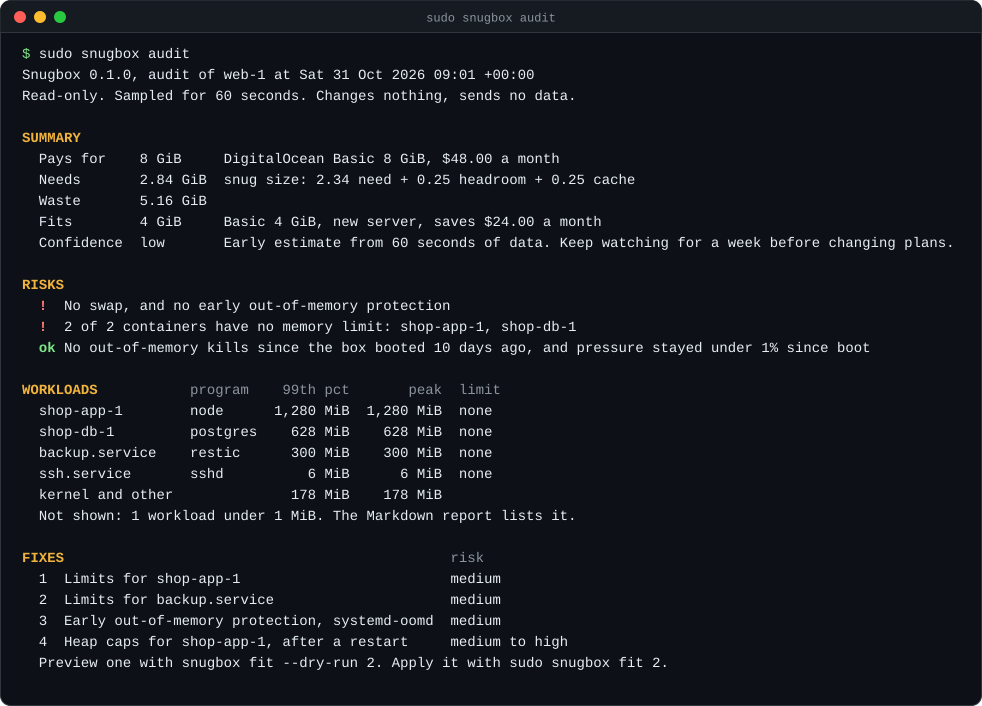
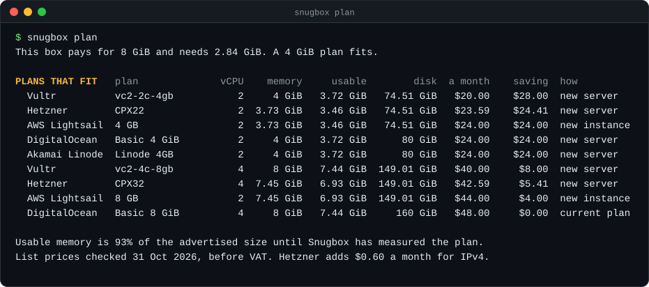

<div align="center">

<picture>
  <source media="(prefers-color-scheme: dark)" srcset="docs/images/snugbox-lockup-inverse.svg">
  
</picture>

**Find out how much memory your Linux server really needs.**

Snugbox measures what every container, service and process uses, fixes the waste with changes you can undo, and names the cheapest plan that fits.

[](https://github.com/snug-box/snugbox/actions/workflows/ci.yml)
[](LICENSE)
[](go.mod)
[](docs/install.md)

[Quick start](#quick-start) · [What it does](#what-it-does) · [Commands](#commands) · [Documentation](#documentation) · [Contributing](CONTRIBUTING.md)



</div>

> [!NOTE]
> The first release, 0.1.0, isn't published yet. Until it is, build Snugbox from source as shown below.

## What it does

- **Measures.** It reads the kernel's own files to tell the memory a workload can't give back from cache the kernel can reclaim, and it keeps watching for 30 days so the answer covers nightly jobs and weekly peaks.
- **Fixes, with an undo.** It offers fixes from a short catalogue. Each one saves the old settings first, is checked for 30 minutes, and is undone on its own if it hurts the workload.
- **Right-sizes.** It compares what the server needs with the plans of DigitalOcean, Hetzner, Vultr, Akamai Linode and AWS Lightsail.
- **Stays small and private.** The watcher's budget is 24 MiB and 0.5% of one CPU core with 50 workloads; on a 1 GiB server with a month of history it used 16.2 MiB and 0.36%. Nothing leaves the server unless you ask for it.

<div align="center">

</div>

## Quick start

Build the command with Go 1.27 and run an audit. It samples the server for a minute, changes nothing and sends no data.

```sh
git clone https://github.com/snug-box/snugbox.git
cd snugbox
go build -o snugbox ./agent/cmd/snugbox
sudo ./snugbox audit
```

To keep watching and to apply fixes, build the packages with `make snapshot`, which needs [GoReleaser](https://goreleaser.com) 2.19 and [Syft](https://github.com/anchore/syft), then install the one for your system and start the watcher:

```sh
sudo dpkg -i dist/snugbox_*_amd64.deb          # Debian and Ubuntu
sudo dnf install ./dist/snugbox-*.x86_64.rpm   # the RHEL family, Fedora and Amazon Linux
sudo snugbox watch install
```

After the first release, `curl -fsSL https://github.com/snug-box/snugbox/releases/latest/download/install.sh | sh` installs a signed build. [Installing, upgrading and removing](docs/install.md) has the details.

## Commands

| Command | What it does |
| --- | --- |
| `snugbox audit` | The read-only report: what the server pays for, needs and wastes, the risks, the fixes and the plans that fit |
| `snugbox watch install` | Run the watcher, which samples every 10 seconds and keeps 30 days of history |
| `snugbox fit` | List the fixes, preview one with `--dry-run`, apply it, and follow it with `--status` |
| `snugbox undo` | Put a fix back from its snapshot |
| `snugbox plan` | Every plan that fits, from the price list in the release |
| `snugbox report` | What changed in the last day, or the last week with `--week` |
| `snugbox top` | A live view of each workload's memory and pressure |
| `snugbox pause`, `resume` | Stop every fix and automatic undo, and start them again |
| `snugbox doctor` | Check the kernel, cgroups, pressure files, zswap and permissions |
| `snugbox self-update` | Update a script install, verified through The Update Framework |

`--json` and `--markdown` give the audit to scripts and files. Exit codes: 0 done, 1 error, 2 wrong usage, 3 risks found, 4 needs root. [Every command and option](docs/reference/commands.md) lists the rest.

## The fixes

| Fix | What it changes |
| --- | --- |
| [Swap with zswap](docs/fixes/swap.md) | A swap file, compressed in memory first |
| [Out-of-memory protection](docs/fixes/oom-protection.md) | systemd-oomd or earlyoom, so a runaway process is stopped before the box freezes |
| [Container limits](docs/fixes/container-limits.md) | Memory limits for Docker containers, kept in a Compose override when the container comes from Compose |
| [Service limits](docs/fixes/service-limits.md) | Memory limits for systemd services, without a restart |
| [Heap caps](docs/fixes/heap-caps.md) | Heap limits for Java, Node.js and Go, and fewer malloc arenas for glibc programs, applied with a restart |
| [Schedules](docs/fixes/schedule.md) | An earlier start for a timer that keeps colliding with another heavy job |

The audit also reports crash loops, headless browsers left running, idle containers, database memory settings and PHP-FPM's `pm.max_children`, and changes none of them.

## How it works

| Program | Runs as | Does |
| --- | --- | --- |
| `snugbox` | You | The command line |
| `snugboxd` | The `snugbox` user, with two read-only capabilities | Watches the server and keeps its history in a small SQLite file |
| `snugbox-helper` | root, in a systemd sandbox, started on demand | The only part that changes anything: it applies and undoes fixes and keeps a hash-chained journal of each change |

On its own, Snugbox contacts only the cloud provider's metadata service at 169.254.169.254, to learn the provider and region; `--offline` turns that off. [What Snugbox reads, keeps and sends](docs/data-policy.md) and [the security model](docs/security-model.md) have the details.

## Tested on

Linux 5.4 or newer with cgroup v2 and systemd 249 or newer, on x86-64 and Arm64, with Docker Engine 25 or newer for containers.

The end-to-end tests pass, a real reboot in the middle of a fix included, in virtual machines of Debian 12 and 13, Ubuntu 22.04, 24.04 and 26.04, AlmaLinux 9 and 10, Rocky Linux 9 and 10, Fedora 44 and Amazon Linux 2023. They also pass on Ubuntu 24.04 servers at Oracle Cloud and Azure, and the read-only checks pass on a busy Google Cloud game server.

## Documentation

- [Installing, upgrading and removing](docs/install.md)
- [Your first audit, and how to read it](docs/audit.md)
- [The memory model](docs/memory-model.md), to check the arithmetic behind the advice
- [Watch mode](docs/watch.md): history, early warnings and settings
- [Fixes](docs/fixes/README.md) and [the helper's journal](docs/journal.md)
- [What `snugbox doctor` checks](docs/doctor.md)
- [The JSON report's schema](schema/audit/v1.json)
- [Decision records](docs/adr/), for why it is built the way it is

## Development

```sh
make check        # lint, tests with the race detector, protobuf and shell checks
make snapshot     # every archive and package in dist/, unsigned
make live-tests   # as root on a disposable machine: the real helper, end to end
make vm-tests     # every supported distribution in a KVM virtual machine
```

CI runs the same checks on every pull request, builds the release, installs the package on GitHub's Ubuntu machines and runs every live test and the memory and CPU budgets against it. [CONTRIBUTING.md](CONTRIBUTING.md) explains how to work on Snugbox.

## Security

Please report security problems privately, as [SECURITY.md](SECURITY.md) describes, never in a public issue.

## License

Apache-2.0; see [LICENSE](LICENSE) and [NOTICE](NOTICE). The modules Snugbox is built from are listed in [THIRD_PARTY_NOTICES.md](THIRD_PARTY_NOTICES.md), and the changes in each release in [CHANGELOG.md](CHANGELOG.md).

Snugbox is built and maintained by [@devpilotX](https://github.com/devpilotX).
